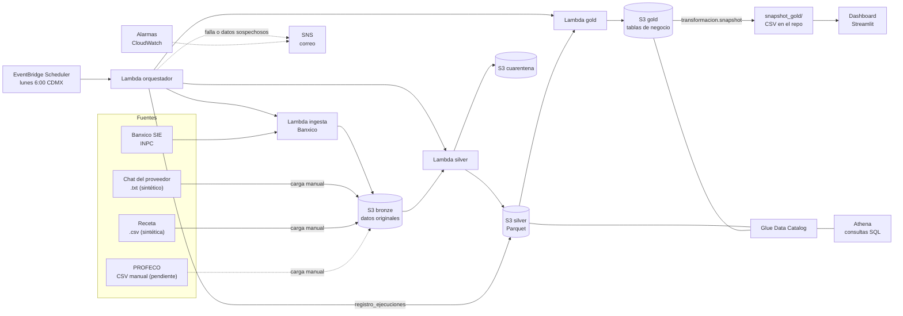

# Índice del Taco

Pipeline de datos en AWS que calcula cada semana el costo de insumos de un taco de suadero y de pastor, lo compara contra el mercado y la inflación, y avisa por correo cuando algo falla. Pensado para La TaquerIA Opus y replicable en cualquier negocio de comida en México.

> **Estado (18/11):** funciona de punta a punta en AWS con datos sintéticos y el INPC real de Banxico (bronze → silver → gold → Athena), se ejecuta sola cada lunes 6:00 (CDMX), registra cada corrida, avisa por correo y tiene dashboard de Streamlit. Responde P1 y P4; **P2 y P3 están incompletas** (falta PROFECO). Detalle de lo hecho, lo pendiente y lo que hay que verificar en el [roadmap](ROADMAP.md).

## El problema

La TaquerIA Opus es una taquería de la Ciudad de México que lleva sus costos "al tanteo". Su proveedor le subió los precios y la dueña no sabe si el aumento es justo. Una revisión anterior se rompió y pasaron dos meses usando números desactualizados sin que nadie lo notara.

El gobierno publica precios de alimentos con frecuencia, pero la información está dispersa y en formatos distintos. Este proyecto la junta con los datos de la taquería y la convierte en una respuesta simple, útil también para cualquier otro negocio de comida.

Responde cuatro preguntas:

| # | Pregunta |
| :---- | :---- |
| P1 | ¿Cuánto cuesta hoy cada taco de suadero y de pastor? |
| P2 | ¿Mi proveedor cobra caro o barato frente al mercado? |
| P3 | ¿Qué insumo explica el aumento de costos? |
| P4 | ¿Mi costo sube más o menos que la inflación? |

## Qué hace

- Procesa el chat de WhatsApp del proveedor exportado como `.txt` (precios con y sin `$`, cambios relativos, correcciones, mensajes sin precios).
- Integra fuentes públicas oficiales de precios e inflación (PROFECO, Banxico e INEGI).
- Calcula el costo por taco en pesos y como índice base 100, la diferencia contra el mercado y la contribución de cada insumo al cambio de costo.
- Aparta los datos con errores en cuarentena en lugar de usarlos.
- Se ejecuta cada semana sin duplicar registros al reprocesar y envía una alerta por correo si falla. La carga del archivo de PROFECO es manual por ahora (ver [fuentes](docs/fuentes.md)).

## Fuentes de datos

| Fuente | Qué aporta | Frecuencia observada |
| :---- | :---- | :---- |
| PROFECO QQP (Quién es Quién en los Precios) | Precios al menudeo y filas de Central de Abasto, que sirven de referencia de mayoreo | Quincenal, con huecos y retraso; descarga manual |
| Banxico SIE | INPC general | Mensual |
| INEGI | INPC, para contrastar con Banxico | Quincenal y mensual |
| Chat de WhatsApp, receta y ventas | Datos internos (sintéticos) | Semanal |

Notas:

- **SNIIM se descartó:** no ofrece descarga ni API. El mayoreo se toma de las filas de Central de Abasto de PROFECO.
- **Comparaciones aproximadas:** PROFECO no trae "pastor" ni "suadero", así que se usan cortes parecidos (pierna de cerdo y cortes de res). Las comparaciones contra el mercado se marcan como aproximadas.

El catálogo completo, con las pruebas de cada fuente, está en [`docs/fuentes.md`](docs/fuentes.md).

## Arquitectura



*Los trazos punteados son avisos o cargas pendientes. La imagen [`docs/img/indice-del-taco-avance.png`](docs/img/indice-del-taco-avance.png) es una versión anterior (dibuja una VPC y disparos por eventos de S3) y no refleja lo construido.*

Arquitectura serverless en capas (medallón). EventBridge Scheduler dispara cada lunes a las 6:00 (CDMX) una Lambda orquestadora que invoca en orden la ingesta de Banxico, silver y gold, registra cada etapa en `registro_ejecuciones` y avisa por SNS si algo falla o hay datos sospechosos ([ADR 0013](docs/adr/0013-orquestacion-eventbridge-y-lambda.md)).

| Capa | Contenido | Para qué sirve |
| :---- | :---- | :---- |
| **Bronze** | Archivos tal como llegaron | Reprocesar cualquier semana desde el dato original |
| **Silver** | Parquet particionado por año/semana, con tipos y unidades normalizadas | Datos limpios y baratos de consultar |
| **Gold** | Tablas de negocio, cada una para al menos una pregunta | Alimenta el dashboard y las consultas |

Tablas gold: `costo_taco_semanal`, `precio_insumo_semanal`, `comparativo_proveedor`, `comparativo_inflacion` y `contribucion_insumo`.

## Decisiones de diseño

- **Serverless y por eventos:** sin servidores encendidos; el costo esperado está dentro del free tier de AWS.
- **Parquet particionado + Athena:** Athena cobra por datos escaneados, así que leer menos datos reduce el costo. En una prueba con el esquema de PROFECO (200 mil filas sintéticas), Parquet escaneó entre **98 % y 100 % menos** bytes que CSV con las mismas respuestas ([`docs/parquet-vs-csv.md`](docs/parquet-vs-csv.md)).
- **Reprocesamiento idempotente:** volver a procesar una semana no duplica registros ni cambia el histórico.
- **Dashboard público sin login:** lee un *snapshot* de las tablas gold, sin precios de compra exactos; los datos del proveedor se quedan en S3 privado. El snapshot permite que el dashboard siga funcionando aunque la cuenta de AWS ya no exista.
- **Infraestructura como código con CloudFormation.**

Todas las decisiones relevantes se registran como ADR en [`docs/adr/`](docs/adr/).

## Seguridad

- MFA en el usuario raíz, que no se usa para trabajar.
- Un usuario o rol IAM por integrante; roles de Lambda con mínimo privilegio.
- Ninguna credencial en el repositorio; los tokens de las fuentes van en variables de entorno o en Parameter Store (ver `.env.example`).
- Buckets de datos con bloqueo de acceso público.
- Alarma de presupuesto (AWS Budgets) activa desde el primer día.

## Datos

El chat del proveedor, la receta y las ventas son **datos sintéticos** generados con un script reproducible (semilla fija), por lo que cualquiera puede obtener exactamente los mismos datos. El generador incluye errores intencionales (precios en cero, fechas inválidas) para probar la cuarentena. Se generan con `datos_sinteticos/generador.py` (decisiones y supuestos en el [ADR 0007](docs/adr/0007-datos-sinteticos-reconstruccion.md)):

```bash
python -m venv .venv && .venv/bin/pip install -r requirements-dev.txt
.venv/bin/python -m datos_sinteticos.generador --semilla 42 --salida data/sintetico   # agrega --sin-errores para un chat limpio
.venv/bin/python -m pytest                                                           # generador y parser
```

Produce `chat_proveedor.txt`, `receta.csv` y `ventas_diarias.csv`. El parser del chat vive en `src/ingesta/parser_chat.py`.

Para generar silver y cuarentena en local (Parquet particionado por año y semana ISO):

```bash
PYTHONPATH=.:src .venv/bin/python -m transformacion.silver_chat --fecha-ingesta 2026-11-16   # solo silver del chat
PYTHONPATH=.:src .venv/bin/python -m transformacion.pipeline_local                              # silver + gold completos en data/lake
```

### Dashboard y snapshot

El dashboard (`dashboard/app.py`) lee `snapshot_gold/`, que se genera desde gold (sin las columnas ni filas con el precio del proveedor; riesgo residual en el [ADR 0012](docs/adr/0012-privacidad-del-snapshot.md)):

```bash
PYTHONPATH=.:src .venv/bin/python -m transformacion.snapshot                       # desde data/lake/gold (pipeline local)
PYTHONPATH=.:src .venv/bin/python -m transformacion.snapshot --bucket <bucket-gold>  # o desde S3 (necesita boto3 y credenciales)
pip install -r dashboard/requirements.txt && streamlit run dashboard/app.py          # ver el tablero
```

Lo que aún no tiene datos (P2, y los insumos de P3 distintos de la carne) se muestra como «Aún sin datos» o «Sin dato», nunca como cero ([ADR 0019](docs/adr/0019-datos-faltantes-sin-dato.md)).

## Cómo desplegarlo

Las plantillas de CloudFormation están en `infra/` (`00` a `07`) y se despliegan en orden; cada stack importa valores del anterior. Los comandos exactos, el empaquetado de las Lambdas y la prueba de la falla simulada están en [`infra/README.md`](infra/README.md). Para recrearlo en otro negocio o cuenta, ver la [guía de réplica](docs/guia_replica.md).

1. Tener una cuenta de AWS y credenciales (`aws login`).
2. Desplegar `01` (bronze), `03` (silver, gold, cuarentena) y `00` (artefactos).
3. Guardar el token de Banxico en Parameter Store (`SecureString`); nunca en el repositorio.
4. Empaquetar el código con `python infra/empaquetar_lambda.py` y desplegar `04` (Banxico), `05` (silver y gold), `06` (Glue y Athena) y `07` (orquestación y alertas, con el correo como parámetro).
5. Para eliminar todo y no generar costos: vaciar los buckets de S3 y borrar los stacks (los buckets tienen `DeletionPolicy: Retain`).

*Pendiente: un script que haga todo esto en un solo comando y la prueba destruir → desplegar (H7).*

## Resultados

Con los datos sintéticos, de enero a septiembre el costo de la carne por taco subió ≈ 12 % y el INPC general ≈ 1.7 % (consultas P1 y P4 interpretadas en [`sql/README.md`](sql/README.md)). *Pendiente: URL pública del dashboard, video demo y costo real de operación ([`docs/costos.md`](docs/costos.md) solo tiene estimaciones).*

### Hallazgos

[EN CONSTRUCCIÓN] *¿El proveedor está caro? ¿El taco subió más que la inflación? ¿Cuánto rinde en realidad un kilo de suadero? Pendiente (H8).*

### Aprendizajes

[EN CONSTRUCCIÓN] *Pendiente (H8).*

## Estructura del repositorio

```text
.
├── docs/
│   ├── consultoria/        # RFP, SOW y aclaraciones
│   ├── adr/                # Registros de decisiones de arquitectura
│   ├── img/                # Diagrama de arquitectura (PNG y JSON de Diagramon)
│   ├── fuentes.md          # Catálogo y validación de las fuentes de datos
│   ├── diccionario_datos.md # Contrato de silver y gold (v0)
│   ├── runbook.md          # Qué hacer ante cada alerta
│   ├── costos.md           # Estimación de costos y controles (el gasto real está sin medir)
│   └── guia_replica.md     # Cómo adaptarlo a otro negocio
├── infra/                  # Plantillas de CloudFormation (00 a 07) y empaquetado de las Lambdas
├── src/                    # ingesta/ (parser, Banxico), transformacion/ (silver, gold, pipeline local, snapshot) y handlers/ (Lambdas); falta PROFECO
├── sql/                    # Consultas de Athena por pregunta (P1 y P4; la DDL está en infra/06)
├── datos_sinteticos/       # Generador reproducible (semilla fija)
├── dashboard/              # Dashboard de Streamlit y su requirements.txt
├── snapshot_gold/          # CSV públicos generados desde gold (los lee el dashboard)
├── tests/                  # Pruebas del pipeline (126), de los handlers y del dashboard
├── .env.example            # Variables de entorno de ejemplo, sin valores reales
├── LICENSE
└── README.md
```

## Documentación

- [RFP](docs/consultoria/rfp.md): lo que pide el cliente.
- [SOW](docs/consultoria/sow.md): alcance, entregables, hitos y presupuesto.
- [Aclaraciones](docs/consultoria/aclaraciones.md): contradicciones encontradas y preguntas pendientes.
- [Fuentes de datos](docs/fuentes.md): validación de cada fuente.
- [Diccionario de datos](docs/diccionario_datos.md) (v0)
- [Runbook](docs/runbook.md), [costos](docs/costos.md) y [guía de réplica](docs/guia_replica.md)
- [Roadmap](ROADMAP.md): estado, pendientes y decisiones provisionales
- [ADRs](docs/adr/): 19 decisiones, todas provisionales hasta que las revise el equipo:
  - **Alcance y cuenta:** [0001 alcance](docs/adr/0001-alcance.md), [0010 cuenta y región](docs/adr/0010-cuenta-aws-y-region.md)
  - **Arquitectura:** [0002 capas y Parquet](docs/adr/0002-capas-parquet-catalogo.md), [0004 CloudFormation](docs/adr/0004-iac-cloudformation.md), [0006 dashboard](docs/adr/0006-dashboard-streamlit.md), [0013 orquestación](docs/adr/0013-orquestacion-eventbridge-y-lambda.md), [0017 idempotencia](docs/adr/0017-idempotencia-y-reproceso.md)
  - **Datos y calidad:** [0007 datos sintéticos](docs/adr/0007-datos-sinteticos-reconstruccion.md), [0011 PROFECO y SNIIM](docs/adr/0011-ingesta-hibrida-profeco-sniim.md), [0014 rezago por fuente](docs/adr/0014-frecuencia-y-rezago-por-fuente.md), [0015 proxies](docs/adr/0015-proxies-pastor-y-suadero.md), [0016 umbrales](docs/adr/0016-reglas-y-umbrales-de-calidad.md), [0018 inflación](docs/adr/0018-inflacion-con-banxico.md), [0019 sin dato](docs/adr/0019-datos-faltantes-sin-dato.md)
  - **Cálculo y privacidad:** [0003 estadístico](docs/adr/0003-estadistico-precio-semanal.md), [0005 salsa](docs/adr/0005-salsa.md), [0008 merma](docs/adr/0008-merma.md), [0009 semana base](docs/adr/0009-semana-base-indice.md), [0012 privacidad del snapshot](docs/adr/0012-privacidad-del-snapshot.md)

## Avance

- [ ] H0 · Arranque *(parcial: falta confirmar la región y el límite de gasto en AWS Settings)*
- [x] H1 · La bodega, a mano
- [ ] H2 · Ingesta automatizada *(Banxico y chat listos; falta PROFECO)*
- [ ] H3 · Silver y SQL *(falta PROFECO y la comparación CSV vs Parquet)*
- [ ] H4 · Gold e Índice del Taco *(P1 y P4 listos; P2 y P3 incompletas)*
- [ ] H5 · Orquestación *(desplegada; falta ver dos corridas automáticas)*
- [ ] H6 · Observabilidad y calidad *(falla simulada probada el 17/11; falta la captura del correo)*
- [ ] H7 · Infraestructura como código completa *(plantillas listas; falta el script y destruir → desplegar)*
- [ ] H8 · Producto y entrega *(dashboard y snapshot listos; faltan URL pública, presentación y video)*

## Equipo

- Gerardo Arredondo Granados (líder técnico y arquitecto)
- Fernanda García Ortega (ingesta)
- Carlos López Estrada (plataforma y costos)
- Alejandro Martínez Jiménez (transformación y calidad)
- Emilio Sebastián Ospino Mérida (modelado y analítica)

## Licencia

[MIT](LICENSE)
