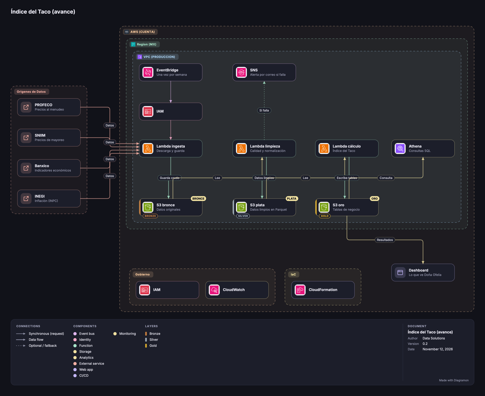

# Índice del Taco

Pipeline de datos en AWS que calcula cada semana el costo de insumos de un taco de suadero y de pastor, lo compara contra el mercado y la inflación, y avisa por correo cuando algo falla. Pensado para La TaquerIA Opus y replicable en cualquier negocio de comida en México.

> **Estado:** en construcción. Las secciones marcadas con [EN CONSTRUCCIÓN] se completan conforme avanzan los hitos (ver [Avance](#avance)).

## El problema

La TaquerIA Opus es una taquería de la Ciudad de México que lleva sus costos "al tanteo". Su proveedor le subió los precios y la dueña no sabe si el aumento es justo. Una revisión anterior se rompió y pasaron dos meses usando números desactualizados sin que nadie lo notara.

El gobierno publica precios de alimentos con frecuencia, pero la información está dispersa y en formatos distintos. Este proyecto la junta con los datos de la taquería y la convierte en una respuesta simple, útil también para cualquier otro negocio de comida.

Responde cuatro preguntas:

| # | Pregunta |
| :---- | :---- |
| P1 | ¿Cuánto cuesta hoy cada taco de suadero y de pastor? |
| P2 | ¿Mi proveedor cobra caro o barato frente al mercado? |
| P3 | ¿Qué insumo explica el aumento de costos? |
| P4 | ¿Mi costo sube más o menos que la inflación? |

## Qué hace

- Procesa el chat de WhatsApp del proveedor exportado como `.txt` (precios con y sin `$`, cambios relativos, correcciones, mensajes sin precios).
- Integra fuentes públicas oficiales de precios e inflación (PROFECO, Banxico e INEGI).
- Calcula el costo por taco en pesos y como índice base 100, la diferencia contra el mercado y la contribución de cada insumo al cambio de costo.
- Aparta los datos con errores en cuarentena en lugar de usarlos.
- Se ejecuta cada semana sin duplicar registros al reprocesar y envía una alerta por correo si falla. La carga del archivo de PROFECO es manual por ahora (ver [fuentes](docs/fuentes.md)).

## Fuentes de datos

| Fuente | Qué aporta | Frecuencia observada |
| :---- | :---- | :---- |
| PROFECO QQP (Quién es Quién en los Precios) | Precios al menudeo y filas de Central de Abasto, que sirven de referencia de mayoreo | Quincenal, con huecos y retraso; descarga manual |
| Banxico SIE | INPC general | Mensual |
| INEGI | INPC, para contrastar con Banxico | Quincenal y mensual |
| Chat de WhatsApp, receta y ventas | Datos internos (sintéticos) | Semanal |

Notas:

- **SNIIM se descartó:** no ofrece descarga ni API. El mayoreo se toma de las filas de Central de Abasto de PROFECO.
- **Comparaciones aproximadas:** PROFECO no trae "pastor" ni "suadero", así que se usan cortes parecidos (pierna de cerdo y cortes de res). Las comparaciones contra el mercado se marcan como aproximadas.

El catálogo completo, con las pruebas de cada fuente, está en [`docs/fuentes.md`](docs/fuentes.md).

## Arquitectura



Arquitectura serverless en capas (medallón). EventBridge Scheduler arranca la ingesta una vez por semana; silver y gold se disparan solos con eventos de S3, con un prefijo distinto por capa para que ninguna Lambda se dispare a sí misma.

| Capa | Contenido | Para qué sirve |
| :---- | :---- | :---- |
| **Bronze** | Archivos tal como llegaron | Reprocesar cualquier semana desde el dato original |
| **Silver** | Parquet particionado por año/semana, con tipos y unidades normalizadas | Datos limpios y baratos de consultar |
| **Gold** | Tablas de negocio, cada una para al menos una pregunta | Alimenta el dashboard y las consultas |

Tablas gold: `costo_taco_semanal`, `precio_insumo_semanal`, `comparativo_proveedor`, `comparativo_inflacion` y `contribucion_insumo`.

## Decisiones de diseño

- **Serverless y por eventos:** sin servidores encendidos; el costo esperado está dentro del free tier de AWS.
- **Parquet particionado + Athena:** Athena cobra por datos escaneados, así que leer menos datos reduce el costo. [EN CONSTRUCCIÓN] *Comparación de bytes escaneados CSV vs. Parquet: pendiente (H3).*
- **Reprocesamiento idempotente:** volver a procesar una semana no duplica registros ni cambia el histórico.
- **Dashboard público sin login:** lee un *snapshot* de las tablas gold, sin precios de compra exactos; los datos del proveedor se quedan en S3 privado. El snapshot permite que el dashboard siga funcionando aunque la cuenta de AWS ya no exista.
- **Infraestructura como código con CloudFormation.**

Todas las decisiones relevantes se registran como ADR en [`docs/adr/`](docs/adr/).

## Seguridad

- MFA en el usuario raíz, que no se usa para trabajar.
- Un usuario o rol IAM por integrante; roles de Lambda con mínimo privilegio.
- Ninguna credencial en el repositorio; los tokens de las fuentes van en variables de entorno o en Parameter Store (ver `.env.example`).
- Buckets de datos con bloqueo de acceso público.
- Alarma de presupuesto (AWS Budgets) activa desde el primer día.

## Datos

El chat del proveedor, la receta y las ventas son **datos sintéticos** generados con un script reproducible (semilla fija), por lo que cualquiera puede obtener exactamente los mismos datos. El generador incluye errores intencionales (precios en cero, fechas inválidas) para probar la cuarentena. [EN CONSTRUCCIÓN] *Instrucciones de uso: pendientes (H1).*

## Cómo desplegarlo

[EN CONSTRUCCIÓN] *La plantilla `infra/template.yaml` todavía no existe; estos son los pasos previstos. Se confirmarán cuando esté lista (H7).*

1. Tener una cuenta de AWS con un usuario IAM propio y MFA activado.
2. En la consola de AWS, abrir **CloudFormation** y elegir **Crear stack**.
3. Subir el archivo `infra/template.yaml` y completar los parámetros (por ejemplo, el correo que recibe las alertas).
4. Esperar a que el stack llegue a `CREATE_COMPLETE`.
5. Para eliminar todo y no generar costos: vaciar los buckets de S3 y borrar el stack.

## Resultados

[EN CONSTRUCCIÓN] *Pendiente (H4 a H8). Aquí irán el dashboard público, el Índice del Taco contra la inflación, el video demo y el costo real de operación.*

### Hallazgos

[EN CONSTRUCCIÓN] *¿El proveedor está caro? ¿El taco subió más que la inflación? ¿Cuánto rinde en realidad un kilo de suadero? Pendiente (H8).*

### Aprendizajes

[EN CONSTRUCCIÓN] *Pendiente (H8).*

## Estructura del repositorio

```text
.
├── docs/
│   ├── consultoria/        # RFP, SOW y aclaraciones
│   ├── adr/                # Registros de decisiones de arquitectura
│   ├── img/                # Diagrama de arquitectura (PNG y JSON de Diagramon)
│   ├── fuentes.md          # Catálogo y validación de las fuentes de datos
│   ├── diccionario_datos.md # [EN CONSTRUCCIÓN]
│   ├── runbook.md          # [EN CONSTRUCCIÓN]
│   └── costos.md           # [EN CONSTRUCCIÓN]
├── infra/                  # [EN CONSTRUCCIÓN] Plantillas de CloudFormation
├── src/                    # [EN CONSTRUCCIÓN] ingesta, transformacion, calidad y gold
├── sql/                    # [EN CONSTRUCCIÓN] DDL de Athena y consultas por pregunta
├── datos_sinteticos/       # [EN CONSTRUCCIÓN] Generador reproducible (semilla fija)
├── dashboard/              # [EN CONSTRUCCIÓN]
├── snapshot_gold/          # [EN CONSTRUCCIÓN] Copia de las tablas gold para el dashboard
├── tests/                  # [EN CONSTRUCCIÓN]
├── .env.example            # Variables de entorno de ejemplo, sin valores reales
├── LICENSE
└── README.md
```

## Documentación

- [RFP](docs/consultoria/rfp.md): lo que pide el cliente.
- [SOW](docs/consultoria/sow.md): alcance, entregables, hitos y presupuesto.
- [Aclaraciones](docs/consultoria/aclaraciones.md): contradicciones encontradas y preguntas pendientes.
- [Fuentes de datos](docs/fuentes.md): validación de cada fuente.
- [ADR 0001: Alcance](docs/adr/0001-alcance.md)

## Avance

- [ ] H0 · Arranque
- [ ] H1 · La bodega, a mano
- [ ] H2 · Ingesta automatizada
- [ ] H3 · Silver y SQL
- [ ] H4 · Gold e Índice del Taco
- [ ] H5 · Orquestación
- [ ] H6 · Observabilidad y calidad
- [ ] H7 · Infraestructura como código completa
- [ ] H8 · Producto y entrega

## Equipo

- Gerardo Arredondo Granados (líder técnico y arquitecto)
- Fernanda García Ortega (ingesta)
- Carlos López Estrada (plataforma y costos)
- Alejandro Martínez Jiménez (transformación y calidad)
- Emilio Sebastián Ospino Mérida (modelado y analítica)

## Licencia

[MIT](LICENSE)
