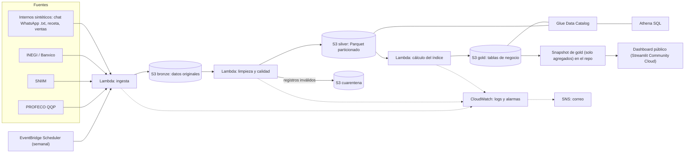

# SOW | El Índice del Taco

**Declaración de trabajo · Propuesta de servicios**

| | |
| :---- | :---- |
| **Consultora** | Data Solutions |
| **Cliente** | La TaquerIA Opus · Representante: Doña Ofelia Ruvalcaba |
| **Respuesta al RFP del** | 06/10/2026 · Propuesta elaborada: 12/10/2026 |
| **Versión** | 1.2 · Revisión del 22/10/2026 · Sujeta a aprobación del cliente |
| **Periodo propuesto** | 21/10/2026 a 27/11/2026 |
| **Equipo** | Gerardo Arredondo Granados (líder); Fernanda García Ortega (ingesta); Carlos López Estrada (plataforma y costos); Alejandro Martínez Jiménez (transformación y calidad); Emilio Sebastián Ospino Mérida (modelado y analítica). |

## 1. Resumen ejecutivo

La TaquerIA Opus necesita conocer el costo semanal de sus tacos de suadero y pastor y saber si los incrementos de su proveedor se justifican frente al mercado. Proponemos un pipeline batch serverless en AWS con arquitectura medallón (bronze, silver y gold) que cada semana procesa el chat exportado del proveedor y las fuentes públicas (PROFECO, SNIIM, INEGI y Banxico), aparta los datos con errores y calcula el Índice del Taco. Los resultados se consultan con SQL (Athena) y se muestran en un dashboard público sin inicio de sesión que lee un *snapshot* de tablas gold agregadas. El sistema avisa por correo cuando algo falla, se despliega con CloudFormation y usa solo servicios básicos dentro de la capa gratuita de AWS. **Entrega propuesta: 27/11/2026; precio total estimado: $828,959.20 MXN, IVA incluido**, con operación mensual esperada cercana a $0 y un tope de **$250 MXN mensuales** (sujeto a consumo real).

## 2. Alcance

### Dentro de alcance

- **Validar y documentar las fuentes** en `docs/fuentes.md`: URL, forma de descarga (archivo, API o página), requisito de registro o token, formato, frecuencia y un archivo de ejemplo de cada una.
- Construir un **generador de datos sintéticos reproducible** (Python, semilla fija) para el chat del proveedor, la receta y las ventas diarias, tomando como semilla el extracto del chat del brief y con errores intencionales (precios en cero, fechas inválidas, unidades desconocidas) para probar la cuarentena.
- **Procesar el archivo `.txt` exportado del chat de WhatsApp** (precios con y sin `$`, unidades implícitas, cambios relativos, correcciones, productos que "siguen igual", mensajes sin precios), con pruebas unitarias. No se conecta a WhatsApp en vivo.
- Integrar información semanal aplicable de **PROFECO (Quién es Quién en los Precios), SNIIM, INEGI (INPC)** y **Banxico (SIE)** como verificación cruzada del INPC.
- Organizar los datos en **capas bronze, silver y gold** en S3, con Parquet particionado, Glue Data Catalog (DDL manual) y consultas en Athena.
- Aplicar **reglas de calidad** (precio válido, fecha válida, unidad reconocida, variación semanal razonable, completitud por fuente y esquema esperado) con cuarentena y alertas.
- Construir las **cinco tablas gold** (costo semanal por taco, precio semanal por insumo, comparativo contra proveedor, comparativo contra inflación y contribución por insumo) y el **Índice del Taco** base 100 para CDMX.
- Automatizar el proceso semanal, evitar duplicados al reprocesar, registrar cada ejecución y enviar alertas por correo en menos de una hora ante fallas o datos sospechosos.
- Desplegar en AWS sin servidores permanentes con **AWS CloudFormation**, solo con servicios básicos dentro del free tier, con permisos mínimos y alarma de presupuesto desde el primer día.
- Publicar un **dashboard público, sin inicio de sesión**, sobre un *snapshot* versionado de las tablas gold, además de una presentación ejecutiva de 10 minutos y un video demo de 3 a 5 minutos.
- Entregar documentación y pruebas unitarias (parser del chat, normalización de unidades y cálculo del índice).

### Fuera de alcance

- Punto de venta, inventario y facturación: no forman parte del problema de comparación de costos.
- Predicción de precios o fijación automática de precios de venta: se ofrecerá análisis histórico, no pronósticos.
- Compras o negociación automática con proveedores: las decisiones comerciales quedan en manos de la dueña.
- Actualización en tiempo real: la frecuencia semanal satisface el objetivo y mantiene bajos los costos.
- Otros tacos, otros productos o ciudades distintas de CDMX, incluida la comparación con otras ciudades (pregunta de extensión del brief).
- Rentabilidad de las gringas y de los pedidos por apps de reparto (comisiones, descuentos), y conciliación de los depósitos de Rappi, DiDi y Uber contra las ventas.
- Conciliación contable contra las compras facturadas en CONTPAQi del Lic. Gutiérrez.
- Modelo financiero para el local de Coyoacán o la posible franquicia en Satélite.
- Aplicación móvil nativa, **conexión en vivo a WhatsApp** y plantillas que obliguen al proveedor a cambiar su forma de enviar precios.
- **Autenticación de usuarios, administración de sesiones y diseño de producto del tablero** (login, pruebas de usabilidad, experiencia móvil dedicada): son desarrollo web, no ingeniería de datos. Los datos sensibles se protegen en el almacenamiento (S3 privado e IAM) y el dashboard solo recibe datos agregados. Ver ADR 0001.
- Difusión pública de precios de compra exactos, ventas o datos del proveedor: son información confidencial.

## 3. Entregables y criterios de aceptación

| # | Entregable | Criterio de aceptación | Hito |
| :---- | :---- | :---- | :---- |
| E1 | Generador de datos sintéticos y parser del chat de WhatsApp | Misma semilla, mismos datos; el parser resuelve los casos del Anexo A del brief (precios con y sin `$`, unidades implícitas, cambios relativos, correcciones, "lo demás igual", mensajes sin precios) con pruebas unitarias que pasan. | H1 / H2 |
| E2 | Ingesta automatizada | Una Lambda por fuente descarga y guarda en bronze con `fecha_ingesta`; ejecutarla dos veces seguidas no duplica datos; hay logs en CloudWatch y los tokens están fuera del código. | H2 |
| E3 | Silver, calidad y consulta SQL | Parquet particionado por año/semana con tipos y unidades normalizadas (con pruebas unitarias); registros inválidos en cuarentena y trazables; tablas en Glue Data Catalog (DDL manual) consultables en Athena; comparación documentada de bytes escaneados CSV vs. Parquet. | H3 |
| E4 | Gold e Índice del Taco | Cinco tablas gold; índice base 100 con semana base y estadístico semanal documentados; una consulta SQL por pregunta (P1 a P4) en `sql/` con su resultado interpretado; recálculo idéntico de cualquier semana desde bronze; pruebas unitarias del cálculo; diccionario de datos. | H4 |
| E5 | Orquestación, observabilidad y runbook | EventBridge Scheduler ejecuta el pipeline completo sin intervención (al menos 2 semanas); resultado antes del lunes 09:00 en pruebas piloto; registro de ejecuciones (fecha, fuente, registros leídos, aceptados, rechazados y duración); correo ≤60 min tras una falla **simulada a propósito**; runbook por alerta. | H5 / H6 |
| E6 | Infraestructura como código, seguridad y costos | Plantillas CloudFormation que recrean todo el sistema (cada hito aporta su parte); grabación de destruir → desplegar → pipeline funcionando; MFA en usuario raíz sin usarlo para trabajar; un usuario o rol IAM por integrante; privilegios mínimos; **cero credenciales en el repositorio**; buckets sin acceso público; alertas de Budgets al 50% y 80%; `docs/costos.md` con el gasto real. | H0 a H7 |
| E7 | Dashboard, snapshot, presentación y video | Dashboard público sin login que lee solo el snapshot de gold; las 4 preguntas (P1 a P4) se pueden leer en él; no muestra precios de compra exactos, ventas ni datos del proveedor; presentación de 10 minutos sin tecnicismos; video demo de 3 a 5 minutos. | H8 |
| E8 | Documentación y guía de réplica | README (problema, a quién sirve, arquitectura, despliegue, resultados, hallazgos y aprendizajes), `fuentes.md`, `diccionario_datos.md`, al menos 5 ADRs, `aclaraciones.md`, runbook y reporte de costos; otro negocio piloto cambia su receta y precios siguiendo la guía, sin modificar código. | H8 |

**Nota de medición:** la meta de disponibilidad semanal del 95% se verificará con pruebas de ejecución y un mecanismo de seguimiento en producción; no puede acreditarse con semanas reales antes de finalizar el proyecto.

## 4. Trazabilidad con el RFP

| Necesidad del RFP | Entregable(s) | Estado propuesto |
| :---- | :---- | :---- |
| N1 · Costo semanal por taco | E1, E2, E3, E4, E5 | Cubierta |
| N2 · Precio del proveedor vs. mercado | E3, E4, E7 | Cubierta |
| N3 · Insumos que explican aumentos | E4, E7 | Cubierta\* |
| N4 · Costo frente a inflación | E4, E7 | Cubierta |
| N5 · Alertas sin fallas silenciosas | E5 | Cubierta |
| N6 · Calidad y reproducibilidad | E1, E3, E4, E5, E6 | Cubierta |
| N7 · Facilidad de comprensión | E7 | Cubierta |
| N8 · Adaptación a otro negocio | E3, E6, E8 | Cubierta |

\* N3 necesita un trimestre de historia. El histórico interno lo cubre el generador sintético (enero a septiembre de 2026, siguiendo el extracto del chat). El histórico público depende de lo que ofrezcan PROFECO y SNIIM; se valida en H0 y, si falta, se muestra solo el periodo real disponible.

## 5. Enfoque técnico (alto nivel)

Arquitectura **batch serverless en AWS** con capas tipo medallón:

- **Bronze:** archivos tal como llegaron, sin editar ni borrar, con `fecha_ingesta`. Es la red de seguridad para reprocesar cualquier semana (N6).
- **Silver:** Parquet particionado por año/semana, con tipos y unidades normalizadas. Lo que no pasa las reglas de calidad va a cuarentena.
- **Gold:** cada tabla responde al menos una pregunta del cliente: `costo_taco_semanal` (P1), `precio_insumo_semanal` (P1, P3), `comparativo_proveedor` (P2), `comparativo_inflacion` (P4, mensual por la frecuencia del INPC) y `contribucion_insumo` (P3).
- **Calidad:** precio mayor a cero y no nulo; fecha válida y no futura; unidad reconocida (si no, cuarentena y alerta para ampliar el catálogo); variación semanal razonable (se marca como sospechoso, no se descarta, porque puede ser real); completitud por fuente (alerta si falta); esquema esperado (si cambia, el pipeline se detiene y avisa). También hay alerta si la cuarentena recibe más de cierto porcentaje de los registros; el umbral se define en H3.
- **Costeo:** `costo_taco = Σ cantidad_por_taco × precio_unitario` por insumo, e `índice = costo de la semana / costo de la semana base × 100`. La carne usa el precio de Don Beto; tortilla, cebolla, cilantro, limón, piña y salsa usan precios públicos, porque no hay precios de compra reales de esos insumos. El estadístico que representa "el precio de la semana" (media, mediana o recortada), la semana base, el tratamiento de la salsa y el de la merma se deciden y se justifican en ADRs.
- **Consulta:** Glue Data Catalog con tablas definidas por DDL manual (sin *crawlers* ni jobs de Glue ETL) y Athena con consultas guardadas en `sql/`. Las Lambdas usan la capa administrada AWS SDK for pandas.
- **Dashboard:** Streamlit Community Cloud lee un *snapshot* de gold versionado en el repo. No requiere login ni servicios de AWS adicionales, y sigue funcionando aunque la cuenta de AWS ya no exista. El snapshot excluye las columnas con precios de compra exactos (por ejemplo `precio_don_beto`), que se quedan en el gold privado; solo salen índices, porcentajes de brecha y de aporte, y el costo por taco en pesos que pide N1. Ver ADR 0006.
- **Servicios y costo:** solo servicios básicos dentro del free tier (EventBridge Scheduler, Lambda, S3, CloudWatch, SNS, IAM, Budgets, Glue Data Catalog y Athena, esta última con costo esperado de centavos). Se evitan NAT Gateway, EC2 o RDS encendidos, Redshift, QuickSight, jobs de Glue ETL, SageMaker, Cognito, API Gateway y Step Functions salvo que sean indispensables. El gasto real se documenta en `docs/costos.md`.
- **Seguridad básica:** MFA en el usuario raíz sin usarlo para trabajar; un usuario o rol IAM por integrante; roles de Lambda con mínimo privilegio por bucket y prefijo; tokens de INEGI y Banxico en Parameter Store (nivel estándar, sin costo) o variables de entorno cifradas, nunca en el repo ni en su historial (si se filtra una credencial, se rota; no basta con borrar el commit); buckets con bloqueo de acceso público.
- **Infraestructura como código:** **AWS CloudFormation.** Cada hito aporta su parte de la plantilla (primero bucket y alarma de presupuesto, luego Lambdas, etc.) para que la infraestructura no quede para el final.
- **ADRs previstos** (en `docs/adr/`): 0001 alcance; 0002 capas, Parquet y catálogo (DDL manual vs. crawler); 0003 estadístico del precio semanal y semana base; 0004 CloudFormation como IaC; 0005 costeo de la salsa y tratamiento de la merma; 0006 dashboard en Streamlit sobre snapshot.

## 6. Plan por hitos

Cada hito existe porque el anterior dejó un problema sin resolver. Las fechas son propuestas; si el profesor define otras, se ajustan.

| Hito | Qué se entrega | Problema que deja abierto | Evidencia | Fecha | Horas |
| :---- | :---- | :---- | :---- | :---- | ----: |
| H0 · Arranque | Cuenta AWS con MFA y roles IAM; alarma de Budgets al 50% y 80%; repo con la estructura acordada; `docs/fuentes.md` con la validación de cada fuente; primera plantilla CloudFormation (bucket y alarma) | Aún no hay datos en la bodega | Captura de la alarma activa; `fuentes.md` con URL, formato, frecuencia, token y archivo de ejemplo | 23/10/2026 | 60 |
| H1 · La bodega, a mano | Bucket con la estructura de capas; un archivo de cada fuente cargado a mano en bronze; generador sintético; receta revisada con supuestos por escrito; `aclaraciones.md` y ADR 0001 | Subir archivos a mano cada semana no escala | Archivos en bronze; script de exploración que muestra los problemas de cada fuente (unidades, huecos, formatos) | 29/10/2026 | 100 |
| H2 · Ingesta automatizada | Una Lambda de ingesta por fuente; parser del chat de WhatsApp con pruebas; tokens fuera del código; plantilla de las Lambdas | Los CSV crudos son pesados, inconsistentes y caros de consultar | Doble ejecución sin duplicados; logs en CloudWatch; pruebas del parser | 04/11/2026 | 140 |
| H3 · Silver y SQL | Lambda de limpieza (tipos, catálogo de insumos, unidades, reglas de calidad, cuarentena); Parquet particionado; Glue Data Catalog y Athena | Los datos están limpios, pero todavía no responden nada | Consultas en Athena; bytes escaneados CSV vs. Parquet; pruebas de normalización de unidades | 10/11/2026 | 150 |
| H4 · Gold e Índice | Cinco tablas gold; cálculo del índice con semana base documentada; diccionario de datos; ADRs 0003 y 0005 | Todo se ejecuta cuando alguien se acuerda | Una consulta SQL por pregunta (P1 a P4) con su interpretación; pruebas del cálculo; doble ejecución sin cambiar resultados | 13/11/2026 | 130 |
| H5 · Orquestación | EventBridge Scheduler dispara el pipeline completo en el orden correcto | Si algo falla un lunes a las 6 a. m., nadie se entera | Al menos dos ejecuciones semanales completas sin intervención humana | 17/11/2026 | 70 |
| H6 · Observabilidad y calidad | Alarmas de CloudWatch, SNS por correo, registro de ejecuciones y runbook; **falla simulada a propósito** | Parte de la infraestructura aún no se recrea con un solo comando | Correo de alerta recibido en ≤60 min; registro de ejecuciones; runbook | 20/11/2026 | 100 |
| H7 · Infraestructura como código completa | Plantillas unificadas y probadas; `docs/costos.md` | El resultado todavía no llega a Doña Ofelia | Grabación de destruir → desplegar → pipeline funcionando | 24/11/2026 | 90 |
| H8 · Producto y entrega | Dashboard en Streamlit sobre el snapshot; presentación de 10 minutos; video demo; README final con hallazgos; aceptación | — | URL pública del dashboard, video, README final y acta de entrega | 27/11/2026 | 150 |
| **TOTAL** | **9 hitos** | | **5 integrantes · 21/10 al 27/11** | | **990** |

Las fechas suponen aprobación del proyecto el 20/10/2026 y disponibilidad oportuna de las fuentes y del cliente. Retrasos ajenos al equipo se gestionan mediante control de cambios (§11). Las 990 horas equivalen a unas 36 horas por persona por semana; se considera un riesgo (§9).

## 7. Equipo y responsabilidades

| Integrante | Rol | Responsabilidad principal | Reporta a |
| :---- | :---- | :---- | :---- |
| Arredondo Granados Gerardo | Líder técnico y arquitecto | Alcance, diagrama de arquitectura, ADRs, integración, revisión de pull requests, cronograma y relación con el cliente. | Doña Ofelia |
| García Ortega Fernanda | Ingesta | Lambdas de ingesta, parser del chat, validación y documentación de fuentes (`fuentes.md`). | Líder |
| López Estrada Carlos | Plataforma y costos | AWS, IAM, CloudFormation, alarmas, Budgets, runbook y reporte de costos. | Líder |
| Martínez Jiménez Alejandro | Transformación y calidad | Generador sintético, silver, reglas de calidad, cuarentena, normalización de unidades y pruebas. | Líder |
| Ospino Mérida Emilio Sebastián | Modelado y analítica | Tablas gold, consultas SQL, dashboard, presentación al cliente y video. | Líder |

**Reglas de trabajo:** todos tocan código de todas las capas; todo cambio entra por pull request revisado por al menos otra persona; cada decisión técnica relevante se registra como ADR.

## 8. Supuestos y dependencias del cliente

- Doña Ofelia designará un enlace (ella o Diego, su sobrino, que tiene acceso a los registros pero disponibilidad limitada por sus prácticas) y aprobará las recetas, cantidades por taco e insumos a más tardar en H1.
- El cliente compartirá el **chat de WhatsApp del proveedor exportado como `.txt`** o, en su ausencia, se usarán datos sintéticos claramente identificados. El equipo no se conectará a WhatsApp en vivo ni pedirá al proveedor llenar plantillas.
- Las inconsistencias entre lo que dice la dueña y lo que muestran los datos se registran en `aclaraciones.md` y se validan con ella. Mientras tanto se trabaja con supuestos explícitos que el dashboard indica:
  - El aumento de "como un 30%" frente a ≈12% en el chat (suadero $165 a $185; pastor $138 a $155).
  - Los tacos por kilo (25, 15 o ≈18 a 20, según la fuente) y los 55 kg diarios de pastor frente a 200 a 400 tacos al día.
  - Un kilo de pastor a ≈$220 según la dueña, frente a $138 a $155 en el chat.
  - La merma: de 6 a 7 kg diarios del trompo que no se registran y no están en la receta.
  - El día en que llegan los precios: lunes por la noche según la dueña, jueves por la mañana según el chat.
- La receta se usa tal cual (55 g de suadero y 50 g de pastor por taco) para el costo teórico, y se reporta una sensibilidad con la merma.
- No hay precios de compra reales de tortilla, verduras, limón, piña ni salsa: se estiman con precios públicos de menudeo o mayoreo y así se declara.
- Las fuentes públicas (PROFECO, SNIIM, INEGI y Banxico) estarán disponibles; INEGI y Banxico requieren registro para obtener un token. Las equivalencias de cortes (suadero, pierna de cerdo adobada) se documentan en `fuentes.md` y requieren visto bueno.
- Cuando falten semanas, datos públicos o equivalencias válidas, se indicará "sin dato" o "último dato disponible", sin inventar precios ni ocultar ausencias.
- Los datos de ventas no son indispensables para el costo unitario; no se construirá un módulo comercial. Los datos sintéticos solo se usan para pruebas y demostraciones, claramente identificados.
- La dueña dará retroalimentación del dashboard en H8, una cuenta de correo para las alertas y acceso a una cuenta de AWS o ambiente acordado.
- Se asume operación ligera dentro del free tier; variaciones importantes de consumo, de acceso a fuentes o de volumen de datos implican reevaluar el costo mensual.

## 9. Riesgos

| Riesgo | Prob. | Impacto | Qué haremos |
| :---- | :---- | :---- | :---- |
| Cambios, caídas o retrasos de PROFECO, SNIIM, INEGI o Banxico | Alta | Alto | Validar en H0, versionar adaptadores, detectar desfases, registrar el último dato válido y alertar; no publicar datos fingidos. |
| Referencia pública no equivalente al insumo real | Alta | Alto | Tabla de equivalencias y aprobación de Doña Ofelia; marcar comparaciones aproximadas. |
| Precios con unidades mixtas, mensajes con correcciones o captura incorrecta | Alta | Alto | Parser y normalización con pruebas unitarias; cuarentena con notificación. |
| Cifras del cliente inconsistentes (30% vs. ≈12%; tacos por kilo; kilo a $220; merma) | Alta | Alto | Registrarlas en `aclaraciones.md`, validarlas con la dueña en H1, usar supuestos explícitos y reportar la sensibilidad. |
| Archivos grandes (por ejemplo, PROFECO) exceden la memoria o el tiempo de Lambda | Media | Medio | Filtrar por CDMX y columnas necesarias al leer, procesar por partes y registrar la decisión en un ADR. |
| Sin histórico de un trimestre para N3 | Media | Medio | Mostrar el periodo real; el histórico interno lo cubre el generador sintético identificado. |
| Falla silenciosa o ejecución duplicada | Media | Alto | Idempotencia, registro de ejecuciones, pruebas de reintento, falla simulada en H6 y alarmas ≤60 min. |
| Exposición de datos del proveedor | Media | Alto | Buckets privados con bloqueo de acceso público, IAM mínimo, cifrado, cero credenciales en el repo y snapshot sin precios de compra exactos; prueba de permisos. |
| Costos AWS > $300/mes o salida del free tier | Media | Medio | Budgets desde H0, solo servicios básicos, evitar los servicios costosos y revisar `docs/costos.md` en cada hito. |
| Cierre de la cuenta de AWS al terminar los créditos | Media | Alto | IaC completa, snapshot de gold versionado y video demo, para que el portafolio sobreviva. |
| Infraestructura como código incompleta al final | Media | Alto | Cada hito aporta su parte de la plantilla; H7 solo unifica y prueba la recreación desde cero. |
| Sobrecarga del equipo (≈36 h por persona por semana, con otras materias) | Alta | Medio | Priorizar E1 a E6 sobre mejoras opcionales; revisión semanal de avance; control de cambios para cualquier ampliación. |
| Demoras en la validación por parte del cliente | Media | Medio | Revisiones dos veces por semana; registro de pendientes y escalamiento en 2 días hábiles. |

## 10. Presupuesto

| Concepto | Horas | Tarifa MXN/h | Subtotal MXN |
| :---- | ----: | ----: | ----: |
| Liderazgo / coordinación | 190 | $700.00 | $133,000.00 |
| Ingeniería de datos | 210 | $650.00 | $136,500.00 |
| Infraestructura y seguridad | 190 | $700.00 | $133,000.00 |
| Calidad de datos | 190 | $580.00 | $110,200.00 |
| Análisis y dashboard | 210 | $650.00 | $136,500.00 |
| **Subtotal de servicios** | **990** | **—** | **$649,200.00** |
| Colchón de imprevistos (10%) | — | — | $64,920.00 |
| AWS durante el proyecto (reserva de 2 meses × $250; gasto esperado cercano a $0) | — | — | $500.00 |
| **Subtotal antes de impuestos** | **—** | **—** | **$714,620.00** |
| **IVA estimado (16%)** | **—** | **—** | **$114,339.20** |
| **TOTAL PROPUESTO, IVA incluido** | **990** | **—** | **$828,959.20** |

Comparación con el RFP: límite total $900,000.00 MXN; margen disponible $71,040.80 MXN (7.9%). Supuesto: el tope incluye IVA y una reserva por imprevistos; la reserva solo se utiliza con autorización. Montos propuestos, no cotizaciones verificadas de terceros.

Operación AWS posterior: diseño limitado a servicios básicos dentro del free tier, con costo esperado cercano a $0 MXN/mes y tope de $250 MXN/mes, por debajo del máximo de $300 MXN/mes del RFP. Es una estimación de bajo volumen, no una tarifa garantizada. AWS Budgets avisará al 50% y al 80% del presupuesto mensual que defina el equipo (la guía del curso sugiere 10 USD, de modo que quede por debajo del tope). El gasto observado se documenta en `docs/costos.md` antes de la aceptación.

## 11. Control de cambios y comunicación

Habrá seguimiento interno continuo y **revisión con Doña Ofelia dos veces por semana** (martes y viernes), por correo o reunión breve, con minuta de acuerdos y pendientes. El líder será el punto único de contacto; las incidencias de ejecución se registrarán en el repositorio y las fallas críticas se comunicarán por correo según E5.

Toda solicitud fuera del alcance se registrará con descripción, justificación e impacto en plazo, costo, riesgos y criterios de aceptación. El líder presentará la evaluación y **solo Doña Ofelia aprobará por escrito** el cambio antes de implementarlo. Se actualizarán SOW, backlog y cronograma cuando aplique; los cambios no autorizados no forman parte de la entrega contratada.

## 12. Aceptación y pagos

Un hito se considerará terminado cuando el equipo entregue su evidencia, se ejecute la demostración o prueba acordada y Doña Ofelia confirme su aceptación por escrito. El cliente tendrá **2 días hábiles** para revisar y reportar observaciones concretas; el equipo resolverá defectos críticos antes de solicitar la aceptación nuevamente. La falta de respuesta no equivale a aprobación automática. H8 cerrará con acta de entrega, acceso al repositorio, manuales, presentación y confirmación de seguridad y funcionalidad.

**Distribución propuesta de pagos** (porcentajes sobre el precio total IVA incluido):

| Hito de aceptación | Porcentaje | Monto MXN |
| :---- | ----: | ----: |
| H0 · Arranque aceptado | 5% | $41,447.96 |
| H1 · Bodega y hallazgos de datos validados | 10% | $82,895.92 |
| H2 · Ingesta automatizada aceptada | 15% | $124,343.88 |
| H3 · Silver y consultas en Athena aceptados | 15% | $124,343.88 |
| H4 · Gold e Índice del Taco validados | 15% | $124,343.88 |
| H5 · Orquestación aceptada | 5% | $41,447.96 |
| H6 · Alertas y runbook aceptados | 10% | $82,895.92 |
| H7 · Infraestructura como código aceptada | 10% | $82,895.92 |
| H8 · Producto y entrega final aceptados | 15% | $124,343.88 |
| **TOTAL** | **100%** | **$828,959.20** |

**Condiciones de cierre:** todas las necesidades N1 a N8 deberán contar con evidencia de cumplimiento o limitaciones documentadas y aprobadas; las pruebas de idempotencia, recreación de infraestructura, protección de datos y alertamiento (con falla simulada) deberán quedar registradas. Las dependencias no disponibles se anotarán en el acta de aceptación y no se presentarán como resultados reales ya verificados.